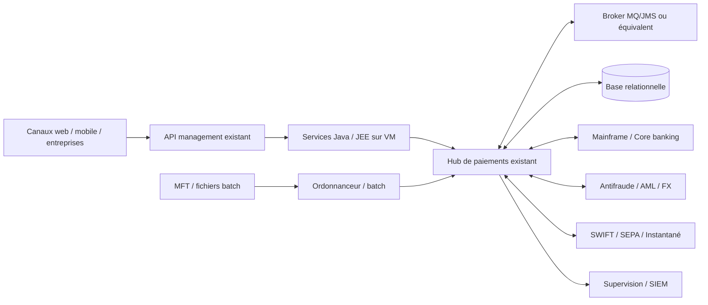
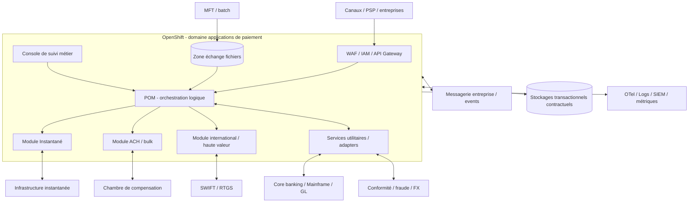
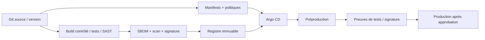
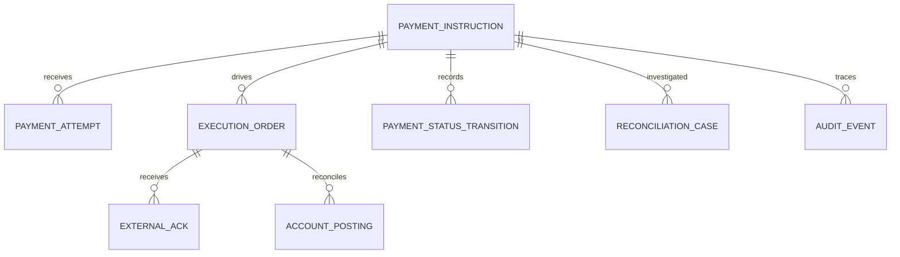
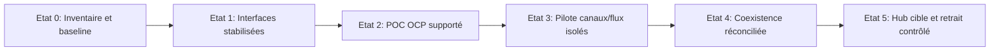

# ÉTUDE INTÉGRALE — FIS OPF / OPENSHIFT
**Architecture de référence — Édition du 18 octobre 2026**
**Périmètre :** paiements bancaires critiques, architecture hybride, modernisation conteneurisée, urbanisation, sécurité, performance, exploitation et arbitrage.
**Qualification :** dernière génération de produit supposée à partir des sources officielles de 2026, numéro exact non vérifié. Aucun logiciel propriétaire ni preuve de compatibilité contractuelle fournis.
**IMPORTANT :** diagrammes, métriques et contrats en exemple ne constituent pas la documentation technique FIS ni une preuve de mise en production.

## Sommaire

1. CADRAGE — `docs/00-cadrage/hypotheses-et-perimetre.md`
2. EXIGENCES ET TRAÇABILITÉ — `docs/00-cadrage/exigences-tracabilite.md`
3. STRATÉGIE ET DÉCISION — `docs/00-cadrage/strategie-et-decisions.md`
4. CAPACITÉS MÉTIER — `docs/01-fonctionnel/capacites-parcours.md`
5. FLUX ET RÈGLES — `docs/01-fonctionnel/flux-metier.md`
6. ANALYSE DE L’EXISTANT — `docs/02-existant/cartographie-as-is.md`
7. IMPACTS INTER-SYSTÈMES — `docs/02-existant/analyse-impacts.md`
8. ARCHITECTURE CIBLE HLD — `docs/03-architecture/hld-cible.md`
9. CONCEPTION TECHNIQUE OPENSHIFT LLD — `docs/03-architecture/lld-openshift.md`
10. PATTERNS D’INTÉGRATION — `docs/03-architecture/integration-patterns.md`
11. ZONES RÉSEAU — `docs/03-architecture/zones-reseau.md`
12. ARCHITECTURE DES DONNÉES — `docs/04-donnees/architecture-donnees.md`
13. ISO 20022 ET CONTRATS — `docs/04-donnees/iso20022-et-contrats.md`
14. SÉCURITÉ ET CONFORMITÉ — `docs/05-transverse/securite-et-conformite.md`
15. RÉSILIENCE ET PRA — `docs/05-transverse/resilience-et-pra.md`
16. PERFORMANCES ET CAPACITÉ — `docs/05-transverse/performance-capacity.md`
17. OBSERVABILITÉ ET EXPLOITATION — `docs/05-transverse/observabilite-et-sre.md`
18. NOUVELLES TECHNOLOGIES ET IA — `docs/05-transverse/emergents-et-ia.md`
19. SCÉNARIOS ET ARBITRAGES — `docs/06-trajectoire/scenarios-et-arbitrages.md`
20. ROADMAP — `docs/06-trajectoire/roadmap-migration.md`
21. RISQUES ET ADR — `docs/06-trajectoire/risques-et-adrs.md`
22. LICENCES ET TCO — `docs/06-trajectoire/couts-licences-tco.md`
23. QUESTIONS ÉDITEUR — `docs/06-trajectoire/questions-editeur.md`
24. TESTS ET VALIDATION — `docs/07-validation/strategie-de-tests.md`
25. PORTES DE RECETTE — `docs/07-validation/matrice-de-recette.md`
26. CADENCE ET LIVRABLES — `docs/08-gouvernance/cadence-livrables.md`
27. INSTRUCTION DES DOSSIERS — `docs/08-gouvernance/kit-instruction-architecture.md`
28. COMITOLOGIE ET SUIVI — `docs/08-gouvernance/comitologie-et-suivi.md`
29. RÉFÉRENCES PUBLIQUES — `SOURCES.md`

---

## 1. CADRAGE


### Mission d'architecture de référence

Construire un système d'information de paiements 24/7, interconnecté, évolutif, intégrant une plateforme OPF moderne aux mondes mainframe, serveurs Java/JEE, applications Open, VM et OpenShift. Assurer l'urbanisation, la maîtrise des flux, la capacité d'instruire un grand nombre d'évolutions et l'observabilité des décisions.

### Hypothèses formelles

| ID | Hypothèse | État | Validation requise |
|---|---|---|---|
| H-01 | Produit FIS OPF de génération cloud-native 2026 | HYPOTHESE DE CADRAGE | Version/build/licence par composant |
| H-02 | POM disponible et intégrable aux moteurs paiements | CONFIRME_EDITEUR pour la capacité | Contrats runtime et API réels |
| H-03 | Certains composants peuvent fonctionner sur OpenShift | A_VALIDER | Matrice de compatibilité éditeur |
| H-04 | Architecture bancaire hybride mainframe/Open/VM/Cloud Native | HYPOTHESE | CMDB, interviews, diagrammes à jour |
| H-05 | Base relationnelle, broker d'entreprise, ordonnanceur | HYPOTHESE | Inventaire par flux et environnement |
| H-06 | Criticité et disponibilité 24/7 | CIBLE METIER | Contrat SLO + RTO/RPO par service |
| H-07 | Périmètre SCT Inst, SCT, SDD, SWIFT/RTGS | EXEMPLES | Rail et périmètre contractuels |
| H-08 | Réseaux, seuils, données, protocoles, IDs inconnus | A_VALIDER | Mesures et contrats |

### Frontières de système

**Dans le domaine d'étude** : capture des ordres, contrôle, routage, exécution via moteurs, statuts, réparations, exceptions, intégration aux systèmes de tenue de compte, interfaces avec rails, événements et observation.

**Interfaces adjacentes** : canaux web/mobile/entreprise, API management, IAM, antifraude, AML/sanctions, FX, SWIFT, comptabilité, MFT et mainframe. Les intégrations 3-D Secure, biométrie, tokenisation carte et monétique **ne sont pas attribuées par défaut à OPF** : elles constituent des domaines à cartographier si le périmètre le justifie.

**Hors périmètre** : firmware HSM, conception des réseaux interbancaires eux-mêmes, transformation du cœur bancaire, développement de modules FIS propriétaires, preuve de certification par un simulateur.

### Classification

- `CONFIRME_EDITEUR` — brochure/pages officielles, pas de déduction sur une installation.
- `CONFIRME_STANDARD` — documentation d'une plateforme/autorité.
- `HYPOTHESE` — représentations fictives révisables.
- `PROPOSITION` — décision de conception recommandée et non acceptée.
- `A_VALIDER` — point bloquant demandant une preuve.
- `DEMONSTRATION` — lab sans composants OPF réels.

### Niveaux et décision

L0 cartographie métier → L1 contexte SI → L2 containers/logique → L3 composants/interfaces → L4 déploiement OpenShift. Une décision d'architecture doit préciser : contexte, options, impacts métiers/data/réseau, coûts, risques, sécurité, observabilité, rollback, tests, avis du fabricant, approbation et date de révision.


---

## 2. EXIGENCES ET TRAÇABILITÉ


**Objectif :** couverture des besoins fonctionnels, techniques, risques, décisions, exploitation et gouvernance. Statut initial = `DOCUMENTE, NON VALIDE EN PRODUCTION`. Les preuves ne sont pas des validations éditeur.

| ID | Domaine | Attendu | Livrable de preuve | Statut |
|---|---|---|---|---|
| EX-001 | Métier | cartographie capacités produits et schémas | [01-fonctionnel/capacites-parcours.md](docs/01-fonctionnel/capacites-parcours.md) | DOCUMENTE / A_VALIDER |
| EX-002 | Fonctionnel | parcours instantané, masse, international, exceptions | [01-fonctionnel/flux-metier.md](docs/01-fonctionnel/flux-metier.md) | DOCUMENTE / A_VALIDER |
| EX-003 | Urbanisation | AS-IS hybride et interfaces | [02-existant/cartographie-as-is.md](docs/02-existant/cartographie-as-is.md) | DOCUMENTE / A_VALIDER |
| EX-004 | Intégration | API synchronous et contrats | [03-architecture/integration-patterns.md](docs/03-architecture/integration-patterns.md) | DOCUMENTE / A_VALIDER |
| EX-005 | Intégration | messaging fiable commandes | [03-architecture/integration-patterns.md](docs/03-architecture/integration-patterns.md) | DOCUMENTE / A_VALIDER |
| EX-006 | Intégration | événements/pub-sub | [03-architecture/integration-patterns.md](docs/03-architecture/integration-patterns.md) | DOCUMENTE / A_VALIDER |
| EX-007 | Applicatif | Java/JEE legacy et stratégie coexistence | [02-existant/analyse-impacts.md](docs/02-existant/analyse-impacts.md) | DOCUMENTE / A_VALIDER |
| EX-008 | Plateforme | Kubernetes/OpenShift/Red Hat | [03-architecture/lld-openshift.md](docs/03-architecture/lld-openshift.md) | DOCUMENTE / A_VALIDER |
| EX-009 | Réseau | cartographie zones/flux/protocoles | [03-architecture/zones-reseau.md](docs/03-architecture/zones-reseau.md) | DOCUMENTE / A_VALIDER |
| EX-010 | Données | modèle conceptuel, data quality | [04-donnees/architecture-donnees.md](docs/04-donnees/architecture-donnees.md) | DOCUMENTE / A_VALIDER |
| EX-011 | Paiement | ISO 20022/SEPA/SWIFT | [04-donnees/iso20022-et-contrats.md](docs/04-donnees/iso20022-et-contrats.md) | DOCUMENTE / A_VALIDER |
| EX-012 | Résilience | 24/7 et défaillances | [05-transverse/resilience-et-pra.md](docs/05-transverse/resilience-et-pra.md) | DOCUMENTE / A_VALIDER |
| EX-013 | Performance | latence, débits, capacité | [05-transverse/performance-capacity.md](docs/05-transverse/performance-capacity.md) | DOCUMENTE / A_VALIDER |
| EX-014 | Sécurité | Zero Trust et segmentation | [05-transverse/securite-et-conformite.md](docs/05-transverse/securite-et-conformite.md) | DOCUMENTE / A_VALIDER |
| EX-015 | Conformité | DORA, RGPD, périmètre PCI | [05-transverse/securite-et-conformite.md](docs/05-transverse/securite-et-conformite.md) | DOCUMENTE / A_VALIDER |
| EX-016 | Sécurité | crypto-agilité et futur post-quantique | [05-transverse/emergents-et-ia.md](docs/05-transverse/emergents-et-ia.md) | DOCUMENTE / A_VALIDER |
| EX-017 | Disponibilité | reprise transactionnelle/anti-doublon | [05-transverse/resilience-et-pra.md](docs/05-transverse/resilience-et-pra.md) | DOCUMENTE / A_VALIDER |
| EX-018 | Run | monitoring, SRE, runbooks | [05-transverse/observabilite-et-sre.md](docs/05-transverse/observabilite-et-sre.md) | DOCUMENTE / A_VALIDER |
| EX-019 | Impacts | composants et flux inter-systèmes | [02-existant/analyse-impacts.md](docs/02-existant/analyse-impacts.md) | DOCUMENTE / A_VALIDER |
| EX-020 | Migration | cible + architecture de transition | [06-trajectoire/roadmap-migration.md](docs/06-trajectoire/roadmap-migration.md) | DOCUMENTE / A_VALIDER |
| EX-021 | Arbitrage | comparaison scénarios risques | [06-trajectoire/scenarios-et-arbitrages.md](docs/06-trajectoire/scenarios-et-arbitrages.md) | DOCUMENTE / A_VALIDER |
| EX-022 | Décisions | avis d’architecture et ADR | [06-trajectoire/risques-et-adrs.md](docs/06-trajectoire/risques-et-adrs.md) | DOCUMENTE / A_VALIDER |
| EX-023 | Livrables | CR ateliers sous une semaine | [08-gouvernance/cadence-livrables.md](docs/08-gouvernance/cadence-livrables.md) | DOCUMENTE / A_VALIDER |
| EX-024 | Livrables | HLD transition sous trois semaines | [08-gouvernance/cadence-livrables.md](docs/08-gouvernance/cadence-livrables.md) | DOCUMENTE / A_VALIDER |
| EX-025 | Livrables | avis et cartos sous un mois | [08-gouvernance/cadence-livrables.md](docs/08-gouvernance/cadence-livrables.md) | DOCUMENTE / A_VALIDER |
| EX-026 | Pilotage | suivi comités hebdomadaire | [08-gouvernance/comitologie-et-suivi.md](docs/08-gouvernance/comitologie-et-suivi.md) | DOCUMENTE / A_VALIDER |
| EX-027 | Cadence | plusieurs centaines demandes/an | [08-gouvernance/kit-instruction-architecture.md](docs/08-gouvernance/kit-instruction-architecture.md) | DOCUMENTE / A_VALIDER |
| EX-028 | Qualité | recette de livrables et critères | [07-validation/matrice-de-recette.md](docs/07-validation/matrice-de-recette.md) | DOCUMENTE / A_VALIDER |
| EX-029 | Risques | points bloquants éditeur support | [06-trajectoire/questions-editeur.md](docs/06-trajectoire/questions-editeur.md) | DOCUMENTE / A_VALIDER |
| EX-030 | Anticipation | IA et paiements émergents cadrés | [05-transverse/emergents-et-ia.md](docs/05-transverse/emergents-et-ia.md) | DOCUMENTE / A_VALIDER |

### Règle de fermeture

Une exigence n’est `VERIFIEE` qu’avec identifiant de test, run, résultat daté, architecture/réglementation applicable, propriétaire et approbateur. Une description documentaire seule ne suffit pas.


---

## 3. STRATÉGIE ET DÉCISION


### Besoin et critères de succès

Mettre à disposition un hub de paiements agile sans rupture de tenue de compte ni dégradation de la chaîne de paiement : traitements instantanés, internationaux et de masse, disponibilité élevée, conformité, sécurité et coûts maîtrisés. Éviter un big bang ; assurer la coexistence, la réconciliation et la responsabilité de chaque domaine.

**Arbitrage :** conserver les moteurs existants pendant le déploiement de la couche de capture / orchestration lorsqu'elle le permet ; basculer progressivement les familles de paiements, sous réserve de support FIS. Une bascule à deux moteurs actifs sans propriété unique de l'ordre et sans réconciliation est refusée.

### Grille pondérée (PROPOSITION)

| Critère | Poids | A: OPF moderne OCP | B: maintien VM | C: façade découplée | D: service hébergé |
|---|---:|---:|---:|---:|---:|
| Maîtrise d'exploitation sur site | 15 | 5 | 5 | 4 | 2 |
| Support éditeur établi | 25 | 2 | 4 | 3 | 3 |
| Réversibilité | 15 | 4 | 4 | 4 | 2 |
| Résilience / HA prouvable | 20 | 4 | 3 | 3 | 4 |
| Délai / complexité transformation | 15 | 3 | 5 | 4 | 3 |
| Coûts maîtrisables | 10 | 3 | 3 | 3 | 2 |

Notes 1 à 5 **illustratives**, basées sur hypothèses seulement ; `support éditeur` doit être re-noté dès réception des pièces. Un score n'autorise jamais une mise en production sans gates.

### Gates incontournables

G0 périmètre connu ; G1 support/licence écrit ; G2 design approuvé ; G3 contrats/états validés ; G4 résilience/performance prouvées ; G5 sécurité/audit/continuité approuvés ; G6 préprod et recette signées ; G7 bascule avec rapprochement 100 % des mouvements traités. Les exceptions sont explicitées et signées, jamais implicites.


---

## 4. CAPACITÉS MÉTIER


### Carte des capacités L0

| Capacité | Sous-capacités | Données clés | KPI métier |
|---|---|---|---|
| Acquisition | API, fichiers, événements, canaux | Ordre, origine, empreinte | taux d'acceptation, distribution |
| Contrôle | format, schéma, sanctions, fraude, limites | évaluation, résultat, motif | taux STP, faux positifs |
| Orchestration | décision de rail, timers, états, exception | instruction, corrélation, décision | délai médian/P99, backlog |
| Exécution | instantané, lots/ACH, international/RTGS | message rail, statut, règlement | délai de confirmation, erreurs |
| Tenue de compte | réservation/débit/crédit/écritures | compte, mouvement, référence | écarts de balance |
| Supervision métier | OVA/portail exploitation, SLA, pistes d'audit | état, événement, acteur | en attente, rejets, délais |
| Compensation/réconciliation | rapprochement, anomalies, réparation | relevé, montant, numéro | écart non rapproché |
| Pilotage produit | règle tarifaire, limite, échéance, version | paramétrage, rulebook | changements sans défaut |

### Cartographie des acteurs

- **Débiteur / entreprise / partenaire** : initie un ordre et reçoit un accusé.
- **Canal + IAM** : authentifie, autorise, remet une preuve de consentement si requise.
- **Hub OPF** : consolide et coordonne des responsabilités métier, selon modules présents.
- **Core banking** : exécute les changements de tenue de compte selon contrat.
- **Infrastructure de clearing / SWIFT / RTGS** : apporte statuts et confirmations.
- **Compliance / fraude** : contrôle des risques et décisions.
- **Opérateur** : instruit une anomalie avec double contrôle lorsque requis.

### Parcours représentatifs à documenter de bout en bout

1. Virement instantané nominal : réception → contrôle → exécution → réponse finale → audit.
2. Timeout canal après acceptation : recherche par référence, jamais création aveugle.
3. Timeout rail après émission : état ambigu, interrogation/réconciliation, pas de double ordre.
4. Paiement international : contrôle sanctions/FX, routing, SWIFT, statuts et investigations.
5. Lot SEPA : ingestion MFT → validation entête/éléments → traitement individuel → statuts agrégés.
6. Rejet avant règlement : code métier, information client, correction et nouvelle instruction.
7. Retour/annulation après règlement : transaction compensatoire selon rail et règle applicable.
8. Dégradation du core : état déterministe, file durable et reprise après rétablissement.
9. Maintenance de nœud OCP : quiescence/drain, statut conservé, reprise.
10. Réconciliation de fin de journée ou quasi temps réel : corrélation ordre/rails/compte/audit.

**Ne pas confondre** date métier, instant de réception, acceptation technique, acceptation métier, émission rail et règlement irrévocable. Les statuts et responsabilités sont fixés par contrats, pas par seule nomenclature.


---

## 5. FLUX ET RÈGLES


### Automate conceptuel d'ordre (non FIS)

`RECEIVED → VALIDATED → ACCEPTED → DISPATCHED → {SETTLED | REJECTED | PENDING_RECONCILIATION}`. Autres transitions possibles : `VALIDATION_FAILED`, `CANCEL_REQUESTED`, `RETURN_INITIATED`, `RETURNED`, `EXPIRED`. **Les événements de chaque rail sont plus complexes** ; cet automate n'est qu'un modèle d'analyse, jamais la vérité d'un module OPF.

### Règles non négociables

| Réf | Règle | Contrôle de preuve |
|---|---|---|
| BR-01 | Une instruction possède une identité stable et une corrélation jusqu'au règlement | lookup / réconciliation complète |
| BR-02 | Même demande métier + même clé => résultat original / statut, pas nouveau paiement | concurrence et crash injectés |
| BR-03 | Une réponse HTTP 504 **n'implique pas** échec de paiement | interrogation par référence |
| BR-04 | Un accusé MQ ou HTTP n'est pas la preuve d'un règlement définitif | preuve rail et compte |
| BR-05 | Un statut indéterminé ne déclenche pas un second mouvement automatique | quarantine + résolution |
| BR-06 | Une correction de message ne réécrit pas silencieusement un ordre réglé | piste d'audit inviolable |
| BR-07 | Les transformations ISO doivent conserver champs métier et références | tests aller-retour/profils |
| BR-08 | Fraude / conformité / VOP sont positionnés selon règles effectives | matrices de séquence signées |
| BR-09 | Les horodatages portent fuseau, source et temps de référence | comparaison et dérive |
| BR-10 | Les rapprochements expliquent tous mouvements et écarts | zéro écart inexpliqué à clôture |

### Gestion de la réponse ambiguë

1. Identifier commande et référence métier durable.
2. Inspecter l'état persistant de la commande, des émissions rail et des écritures.
3. Corréler par `paymentId`, `endToEndId`, identifiant de message ou équivalent contractuel.
4. Éviter un retry tant que le protocole de reprise sûr n'est pas spécifié.
5. Rejouer une **étape idempotente** seulement après preuves et journalisation.
6. Lever incident et saisir l'opérateur si l'état du rail ne peut être déterminé.

### Gouvernance des changements

Chaque règle de routing, limites et cutoffs doit avoir identifiant, version, tests de cas limites, responsable métier, dates d'effet et plan de retour. Modifications à quatre yeux pour domaines critiques.


---

## 6. ANALYSE DE L’EXISTANT


**Ce diagramme n'est la topologie d'aucune banque.** Il sert de checklist pour construire une cartographie réelle lorsque les éléments d'inventaire seront autorisés.



### Fiche d'inventaire obligatoire par application

`app_id, owner métier, owner technique, criticité, versions runtime/Java/JEE, OS, environnement, zones de sécurité, protocoles, formats, interfaces producteur/consommateur, TPS/débit, latence P50/P95/P99, fenêtres batch, dépendances, timeout, retry, ordre, MQ topics/queues, stockage durable, schema DB, licences, RTO/RPO, audit, données sensibles, certificats, monitoring, tests, mode retour arrière`.

### Démarche de collecte

- **D0** liste des capacités, produits, apps et tiers critiques ; refuser les équipements « boîte noire ».
- **D1** cartographie flux L2/L3 issue des journaux, API specs, MFT et broker (lecture seule).
- **D2** mesures métriques réelles en pointe et lors des rejets ; identifier les goulots.
- **D3** dépendances communes : référentiels, IAM, DNS, HSM, Oracle, MQ, ordonnanceur, NTP, certificats.
- **D4** matrice d'impacts des releases (cycle de vie/contrat versionné).
- **D5** validation atelier avec propriétaires et exploitation ; signature de complétude.

### Zones de risques classiques à vérifier

XA/JTA et transaction inter-ressources, base mutualisée, traitements batch non réentrants, sessions en mémoire, fichiers locaux, échanges JMS transverses, règles métier dans scripts, ordonnanceur central, versions Java dépendantes de serveurs anciens, SLA dépendants du mainframe, proxy HTTP avec retries implicites.


---

## 7. IMPACTS INTER-SYSTÈMES


| Évolution hypothétique | Apps | Flux | Données | Sécurité | Exploitation | Décision |
|---|---|---|---|---|---|---|
| Migration façade API sur OCP | canaux, POM, IAM | TLS, timeout, headers | idempotency key | OAuth/mTLS, WAF | traces, rate limit | adapter hors cœur |
| Introduction broker d'événements | hub, SIEM, data | messages, ordering | schema registry/PII | ACL topics | lag, DLQ | events après commit |
| Déplacement runtime Java/JEE | WAR/EAR, DB, MQ | JDBC, JMS/JNDI | transactions XA | UID, secrets | GC, probes | avec approbation éditeur |
| Modification rail instantané | moteurs, CBIS, core | réponses temps réel | statuts/horloge | signatures/certificats | alerte deadlines | qualification métier |
| Changement schéma ISO | adaptateurs, archivage | versions pain/pacs/camt | mapping | intégrité | versionnement | tests rulebook |
| Bascule zone DC | hubs, brokers, BD | latence réseau | réplication, perte | routes et DNS | PRA | scénario chronométré |

### Fiche d'instruction d'une évolution

1. Identité de la demande, origine, objectif métier, urgence, risques.
2. AS-IS certifié par propriétaires, hypothèses restantes.
3. Alternatives au moins A/B, impacts L0-L4, dette et coûts.
4. Chaîne d'événements et propriétés de livraison, timeouts, retours.
5. Criticité des données, RGPD, couverture réglementaire selon périmètre.
6. SLO/RTO/RPO et preuves avant / après.
7. Tests de sécurité, charge, chaos, réconciliation ; responsabilités.
8. Décision datée, approbateur, exceptions, échéance de revue.

### Matrice RACI proposée

`Architecte fonctionnel` responsable objectifs/règles ; `Architecte applicatif` concepteur flux/contrats ; `Architecte plateforme` OCP/réseau ; `RSSI` sécurité ; `DBA/Middleware` ressources d'état ; `Product owner paiements` statuts/rail ; `SRE` SLO/PRA ; `Éditeur` support et licences ; `Design Authority` arbitre. RACI par dossier à finaliser lors du cadrage.


---

## 8. ARCHITECTURE CIBLE HLD


### 1. Drivers

24/7 ; faible latence instantanée ; cohabitation batch/temps réel ; ouverture API ; sécurité de bout en bout ; minimisation des couplages ; réconciliation des paiements ; traçabilité ; évolutivité des rails ; conformité et coûts contrôlés.

### 2. Architecture logique L1–L2



**Lecture :** les noms des modules sont des capacités publiques (S01–S03). Les échanges internes, sens des connexions et choix de stockage illustrent une **PROPOSITION** sans préjuger du déploiement FIS. L'architecture peut répartir les composants sur VM ou OCP selon la matrice éditeur.

### 3. Responsabilités de domaines

| Domaine | Responsabilité | Contrat |
|---|---|---|
| Edge | AuthN/Z, WAF, termin TLS, throttling | OAuth/mTLS selon parcours, OpenAPI approuvée |
| POM | capture, préparation/routage, publication statut | Contrats POM réels FIS à obtenir |
| Execution | rails, schémas, règles, statut final | Format/protocole/fenêtre par rail |
| Integration | CBIS et services utilitaires | Adaptateurs contractuels et SLA |
| Data | vérité durable, transaction & preuve | atomicité, durabilité, backups |
| Event backbone | diffusion des événements métiers | at-least-once + idempotence ou contrat prouvé |
| Observability | santé, KPI, diagnostic, audit | SLI/SLO, traces minimisées PII |

### 4. Architecture de déploiement L4 proposée

Zones distinctes ingress/API, runtime paiements, middleware, data, réseaux bancaires externes, gestion/outillage. Multi-nœuds/zonage et politiques réseau deny-by-default. Aucune instance de base, broker ni module réel FIS n'est fournie par ce dépôt.

### 5. Chaînes critiques

- **Paiement instantané** : perte temporaire de réponse externe, priorisation de l'état ambigu, timer métier de bout en bout.
- **Batch/ACH** : fichiers atomiques, contrôles de complétude, batch chunking, rejet à l'élément et au lot.
- **International** : normes messages, routage, conformité, change, investigations, règles de cutoffs.
- **Canaux API** : retry contrôlé et consultation du statut avant émission d'une seconde commande.
- **Core banking** : indisponibilités programmées/inopinées, conservation du statut et reconciliation.

### 6. Invariants de design

- Aucun double débit/règlement dû à une défaillance du hub ; aucune perte silencieuse d'ordre accepté.
- Une propagation événementielle ne remplace pas l'accusé de règlement.
- Rollout sans perte de messages : arrêt gracieux/drain + tests d'incident.
- Pas de nouveau point unique de défaillance ; pas de dépendance entre disponibilité d'une API et celle d'un outil facultatif d'observation.
- Tous les traitements PII respectent finalité, minimisation, chiffrement et durée de conservation définies.

### 7. Gates de validation

G1 version OPF / support OCP / licences ; G2 contrats ; G3 crash/rejeu ; G4 performances ; G5 audit sécurité ; G6 PRA/test restauration ; G7 approbation opérationnelle. Voir [plan de recette](docs/07-validation/matrice-de-recette.md).


---

## 9. CONCEPTION TECHNIQUE OPENSHIFT LLD


### Précondition absolue

**Interdiction d'assimiler l'émulateur fourni à OPF** : une image FIS doit être obtenue contractuellement. Le fichier `poc/` ne valide que des patterns Kubernetes génériques. Il faut exiger une lettre écrite de compatibilité : version OPF **et modules**, Java/runtime, OCP, CSI/stockage, broker, DB, crypto, opérateurs, patch level et mode de support.

### Plan de déploiement souhaité

| Brique | Choix de référence | Condition |
|---|---|---|
| Workload | Deployments/StatefulSets **selon packaging éditeur** | Ne pas inventer un container par module |
| OCP | version sous support validé par éditeur | pas de numéro arbitraire figé |
| Namespaces | `payments-dev`, `payments-preprod`, `payments-prod`, `payments-ops` | environnements isolés et RBAC |
| Image | registre privé immuable digest SHA256 | signature, SBOM, antivirus, licence |
| Security | `restricted-v2` par défaut, UID dynamique et capacités Linux minimales | images compatibles ou exception validée |
| Service | interne ClusterIP / Route contrôlée sur edge | éviter exposition des backends |
| Secrets | coffres centralisés + rotation, CA d'entreprise | ne pas committer secrets |
| Rollout | selon protocole de cluster/version produit | rolling seulement si états/schémas compatibles |
| Scaling | HPA/VPA selon tests et support | vérifier DB pools, MQ consumers, cohérence |
| Availability | réplicas, PDB, anti-affinité/topologySpread | PDB ne protège pas d'un crash involontaire |
| Monitoring | collecte métriques/logs/traces contrôlée | ne pas exposer identifiants sensibles |

### Chaîne GitOps de référence



**Règle :** les modifications applicatives et configurationnelles suivent des workflows distincts ; rollback du manifest n'implique pas rollback de schéma DB ni effacement d'un ordre. Redéploiement seulement si la gestion d'état l'autorise.

### Probes / cycle de vie

- `startupProbe` : démarrage réel, migration initiale, warm-up (ne pas rendre la sonde dépendante d'un appel rail externe).
- `readinessProbe` : capacité locale d'accepter de **nouvelles** demandes, pas santé totale de l'écosystème.
- `livenessProbe` : deadlock irrécupérable uniquement ; toute dépendance extérieure transitoire ne doit pas tuer un pod.
- `preStop` / SIGTERM : fermer l'admission, drainer/tracer/restituer tâches, respecter `terminationGracePeriodSeconds`.
- Timeouts calculés en tenant compte des traitements et du budget métier.

### Plan d'intégration et sécurité

- `NetworkPolicy` deny-all ingress/egress ; règles explicites DNS/API/middlewares/données/observabilité ; tests effectifs via capture de flux autorisée.
- Egress externe via passerelles tracées, MTLS/cert management, DNS et NTP d'entreprise.
- `ServiceAccount` dédiée sans token API auto-monté si inutile ; RBAC restrictif.
- Read-only filesystem si supporté ; volumes scratch dédiés pour répertoires temporaires.
- Scan d'image et d'admission des conteneurs ; `oc adm policy` seulement après approbation.

### Tests d'acceptation OCP

OCP-01 admission SCC ; OCP-02 non-root ; OCP-03 connexion DB/broker ; OCP-04 isolement inter-namespace ; OCP-05 liveness/readiness ; OCP-06 drain ; OCP-07 rolling/rollback ; OCP-08 saturation ; OCP-09 certificats ; OCP-10 secret rotation ; OCP-11 HA ; OCP-12 restauration ; OCP-13 upgrades ; OCP-14 échec DNS ; OCP-15 réseau sortant interdit.


---

## 10. PATTERNS D’INTÉGRATION


### Principes

Une API REST synchrone, une commande asynchrone dans une file et un événement métier de diffusion sont **trois contrats distincts**. Ne jamais choisir Kafka ou MQ uniquement par mode. Chaque pattern est documenté par problème, mécanisme, garantie, limites, usage, validation.

| ID | Pattern | Problème résolu | Garantie/limite | Exemple et test |
|---|---|---|---|---|
| P-01 | API Gateway + BFF | accès canaux sécurisés | API n'est pas une transaction distribuée | JWT/mTLS/rate-limiting |
| P-02 | Request-Reply + Timeouts | consultation immédiate | timeout ≠ échec métier | rejouer lecture idempotente |
| P-03 | Command Queue / competing consumers | travail durable différé | broker ACK ≠ règlement | crash entre consume et commit |
| P-04 | Publish-Subscribe | notifications multi-usages | consommateurs peuvent être retardés | schéma versionné et DLQ |
| P-05 | Idempotent Consumer | livraison au moins une fois | déduplication durable obligatoire | duplicate + concurrence |
| P-06 | Transactional Outbox | désynchronisation DB/event | atomique avec mutation locale seulement | crash avant publication |
| P-07 | Inbox / Processed Events | duplicate ingestion | nécessite clé, index et rétention | retry après timeout |
| P-08 | Saga / compensation | enchaînement de domaines | pas d'atomicité globale ; irréversibilité rail | réponse hors ordre |
| P-09 | Circuit Breaker + Bulkhead | panne d'un service tiers | doit respecter délai métier et statut | anomalie core AML |
| P-10 | Retry + Backoff + Jitter | faute transitoire | retries sur ordres non-idempotents INTERDITS | test répétition contrôlée |
| P-11 | Dead Letter + Quarantine | poison messages | aucune perte silencieuse ni relecture aveugle | incident/manuel/quatre yeux |
| P-12 | CDC + Anti-Corruption Layer | coexistence mainframe/legacy | pas de double propriété transactionnelle | migration progressive |
| P-13 | Strangler / Branch by Abstraction | trajectoire incrémentale | routage unique par transaction | flux témoin puis ramp-up |
| P-14 | Bulkhead métier | isolation instant/batch | capacité DB partagée reste risque | surcharge batch sans impact instant |
| P-15 | Reconciliation | statut incertain / écart | autorité des différentes sources à définir | 100% états expliqués |
| P-16 | Schema / Contract Versioning | évolution messages | profiles ISO non interchangeables | N/N-1 et réjections |

### Sélection des technologies

**REST** : commandes et consultations de statut de canaux lorsque latence/confirmation le permettent. Codes HTTP distinguent transport et acceptation métier ; une 202 n'est pas un règlement.  
**IBM MQ / JMS ou autre broker fiable** : commandes nécessitant stockage durable, ordonnancement et liaison systèmes Open/legacy. La transaction MQ/base demande preuve ; une livraison JMS transmise n'est pas exactement once end-to-end.  
**Kafka / event backbone** : événements immuables de diffusion, tableaux de bord, analytique et abonnés ; ne pas publier sans stratégie d'outbox/transaction. Kafka n'est pas équivalent à un ledger financier.  
**MFT/SFTP** : ingestion de fichiers, contrôles taille/empreinte, quarantaines, versionnement et accusés métier.  
**COBOL/mainframe** : contrat anti-corruption, reprise et sécurité réseau minimales ; ne pas exposer directement en façade externe.

### Contrat de message minimum

`schemaVersion`, `eventId`, `correlationId`, `causationId`, `paymentId`, `occurredAt`, `businessStatus`, `producer`, `sourceSystem`, `reconciliationRef`, `payloadClassification`. Inclure `idempotencyKey` uniquement lorsque pertinente et protéger tout identifiant sensible.

### Exemple de séquence de panne sûre

Commande reçue → transaction locale persiste ordre `ACCEPTED` + outbox → relay publie événement → consommateur réserve idempotent → envoie au rail → crash avant réponse → système marque `UNKNOWN` → interroge/reconcilie → mise à jour vers `SETTLED` ou `REJECTED` sur preuve. **Aucun second débit n'est automatiquement émis**.

Voir [exemples de séquences](diagrams/03-sequences-paiement.mmd).


---

## 11. ZONES RÉSEAU


### Zonage de principe

- **Z0 Canal externe** : internet, partenaires, réseau interne des canaux.
- **Z1 Edge/API** : WAF, DDoS/ingress, API management, identité.
- **Z2 Domaine applicatif** : namespaces/workloads paiement, aucune sortie libre.
- **Z3 Intégration** : service adapters, MQ, gateways inter-zones.
- **Z4 Données** : DB transactionnelle, coffre secrets, HSM selon périmètre.
- **Z5 Échanges interbancaires** : routeur SWIFT/SEPA/RTGS externes sous contrôle.
- **Z6 Administration/observabilité** : GitOps/CI/CD/SIEM/metrics, réseau séparé.

### Catalogue logique de flux à compléter (ports non inventés)

| ID | Source | Cible | Catégorie | Chiffrement | Risque |
|---|---|---|---|---|---|
| NET-01 | Z0 | Z1 | HTTPS entrant | TLS, WAF | abus externe |
| NET-02 | Z1 | Z2 | API front/back | mTLS si profil supporté | identité et latence |
| NET-03 | Z2 | Z3 | API/MQ/JMS | TLS/mTLS | backlog et doublons |
| NET-04 | Z2 | Z4 | JDBC / appels DB | TLS | pool et deadlock |
| NET-05 | Z3 | Z5 | flux interbancaire | canal approuvé | délais et intégrité |
| NET-06 | Z3 | Core | adaptation MQ/API/fichier | tunnel/chiffrement | legacy |
| NET-07 | Z2 | Z6 | métriques/traces/logs | TLS, minimisation | fuite PII |
| NET-08 | Z6 | Z2 | GitOps/administration | RBAC + audit | changements non maîtrisés |

**Avant firewalling** : préciser IP/FQDN, direction, ports, résolution DNS, certificats, protocole, volume, taille max, timeout, identité, classification, environnement, protocole de reprise, équipe propriétaire. La NetworkPolicy Kubernetes ne gouverne pas à elle seule l'ensemble des flux hors cluster.

### Zero Trust

Identité workload + identité humaine + posture machine ; cloisonnement micro-réseau ; politiques egress restrictives ; moindre privilège ; rotation clés ; inventaire des dépendances ; audit. Un simple service mesh ne remplace pas la politique d'identité ni les flux sans HTTP.


---

## 12. ARCHITECTURE DES DONNÉES


### Entités métier (PROPOSITION, non schéma FIS)

| Entité | Identifiant conceptuel | Contenu | Rétention à définir |
|---|---|---|---|
| PaymentInstruction | instructionId | demande, montant, devise, références | conformité / juridique |
| PaymentAttempt | attemptId | tentative technique, canal, latence | exploitation |
| ExecutionOrder | executionId | instruction adressée au moteur/rail | conformité |
| PaymentStatusTransition | transitionId | avant/après, cause, autorité, date | audit |
| ExternalAck | externalAckId | reçu technique / métier | preuve de livraison |
| AccountPosting | postingId | écriture/solde, justificatif | tenue de compte |
| ReconciliationCase | reconciliationId | corrélation, écart et résolution | contrôle financier |
| AuditEvent | auditId | acteur, action, contrôles et provenance | audit |

La modélisation réelle sera alignée sur le dictionnaire FIS, les identifiants de schéma de paiement et le Core Banking ; ne jamais déduire du modèle logique la structure des tables OPF.

### Schéma conceptuel



### Garanties et consistency model

- Une seule **source d'autorité par transition**, explicitement identifiée, est requise.
- Définir les frontières ACID locales et transactions distribuées possibles ; ne pas supposer XA/JTA ou exactement-once global.
- Interdire la correction silencieuse d'une écriture réglée : retour/compensation traçable.
- Eventual consistency uniquement sur les projections où elle est autorisée ; jamais au détriment des obligations réglementaires.
- Versionner les transformations, conserver origine/horodatage et preuves de mapping.
- Qualité : unicité, complétude, format IBAN/BIC, montants, devise, corrélation, non-régression.
- RGPD : minimiser PII, rétention par finalité et contraintes légales, habilitations, chiffrement au repos/en transit.

### Réconciliation

1. Extraction contrôlée des ordres acceptés.
2. Corrélation des événements rail / Core Banking / compte selon références contractuelles.
3. Détection non-réglé, réglé sans ordre, montant/devise divergents, doublon.
4. Classification et ticket avec propriétaire, délai, escalade.
5. Action réparable signée ou preuve d'impossibilité ; journal irréversible.

### Sizing et gouvernance

Dimensions : TPS nominal/pointe, tailles messages, rétention, taux d'échec, index, archivage, WAL/redolog, réplication, disponibilité sauvegardes, latence disque, débit réseau. Taille cible à calculer avec mesures ; pas de taille chiffrée inventée.


---

## 13. ISO 20022 ET CONTRATS


### Catégories de messages (indicatives)

- **pain.001** : initiation client du virement ; **pain.002** : retour de statut à l'initiateur, selon canal.
- **pacs.008** : transfert de crédit interbancaire ; **pacs.002** : réponse/statut interbancaire ; **pacs.004** : retour de paiement ; **pacs.009** : transfert entre institutions financières.
- **camt.052/053/054** : rapports et notifications de cash management ; **camt.056** : demande d'annulation/rappel dans des scénarios spécifiques.
- Les versions/sous-ensembles admis **dépendent** de SCT/SCT Inst, CBPR+, du rail, de la date d'effet et du schéma de place.

### Matrice de contrats à faire signer

| Champ | Attendu |
|---|---|
| ID de contrat | propriétaire, version et période de compatibilité |
| Transport | TLS/API, MQ, Kafka, MFT, ordre livraison |
| Identité | authentification, scopes, confiance |
| Format | ISO base + usage guidelines + contraintes locales |
| Transaction | acceptation technique vs ordre vs règlement |
| Réponse | codes de rejet et mapping métier |
| Qualité | idempotence, duplicate, timeout, retry, DLQ |
| Audit | correlation, conservation et accessibilité |
| Tests | jeu nominal/négatif/bord et golden files approuvés |

### Modèle d'évolution

1. Recevoir les profils de place et leur date d'effet.
2. Construire mapping versionné (sans perte d'information ou transformations documentées).
3. Valider syntaxe XSD puis règles de schéma/usage guidelines et règles métiers.
4. Exécuter tests contractuels de compatibilité N/N-1 lorsque supportée.
5. Certifier les scénarios émission, réception, rejet, retour, replay, timeouts.
6. Déployer par gouvernance release, surveiller les rejets par message.

Attention à la transition CBPR+ SR2026 (S06) ; ne pas supposer qu'une XSD officielle valide toutes les règles de réseau.

### Exemples de contrats

Les contrats dans `contracts/` décrivent **une façade fictive de laboratoire** et non des APIs OPF officielles. Ne pas soumettre les exemples de payloads au réseau de paiement.


---

## 14. SÉCURITÉ ET CONFORMITÉ


### Objectifs de sécurité

Confidentialité, intégrité des ordres et mouvements, disponibilité 24/7, authentification forte, non-répudiation lorsque requise, traçabilité, séparation des responsabilités, conformité et résilience contre ransomware/compromission supply-chain.

### Threat model STRIDE synthétique

| Menace | Surface | Mesure | Vérification |
|---|---|---|---|
| Spoofing | API clients / workloads | IAM, scopes, mTLS, rotation certificats | tests identité refusée |
| Tampering | messages/ordres | intégrité, signature adaptée, hash/audit | modification détectée |
| Repudiation | actions de maintenance | journaux scellés, double validation | corrélation acteur/acte |
| Information disclosure | logs, backups, headers | masquage PII, chiffrement, minimisation | DLP + scans journaux |
| Denial of service | edge, broker, core | quotas, bulkheads, rate limits | charge abusive |
| Privilege escalation | pod et CI/CD | SCC restricted-v2, RBAC, politique images | admission et tests négatifs |

### Sécurité de bout en bout

1. **Identités** : comptes de service distincts, workload identity, accès humains fédérés, RBAC, JIT selon contexte.
2. **Réseaux** : segmentation deny-by-default, flux egress whitelist, DNS résolu et monitoré, bastions d'administration.
3. **Données** : classification, chiffrement avec KMS/HSM selon criticité, rotation, purge légale, prévention fuite vers SIEM.
4. **Images** : sources approuvées, SBOM, analyse, signature, policy en admission, exceptions documentées.
5. **CI/CD** : séparation des rôles builder/deployer/approver, signatures immuables et contrôle de drift.
6. **Runtime** : UID arbitraire, non-root, no privilege escalation, drop ALL capabilities, syscalls filtrés, volume root RO si possible.
7. **Opérations** : break-glass journalisé, accès au moindre privilège, sauvegardes protégées/récupérables.

### Réglementation : décider selon portée réelle

- **DORA** : TIC critiques, plan de continuité, incidents, tests de résilience, tiers TIC et responsabilité (S08). Une étude d'architecture n'est pas automatiquement une prestation opérationnelle réglementée.
- **RGPD** : qualifier données et traitements réels, minimiser PII et accès ; DPIA si nécessaire.
- **ISO 27001/27002** : politiques et contrôle d'accès, preuves, risques.
- **PCI DSS / 3DS** : **seulement si le système manipule des données de cartes ou entre dans le périmètre d'impact CDE**. Un hub de virements scripturaux n'est pas présumé PCI.
- **SWIFT CSP** : applicabilité à la connectivité/gateway et aux opérateurs concernés, à évaluer séparément.
- **Paiements instantanés UE** : règles de place, contrôle de bénéficiaire et délai d'exécution à vérifier par date, entité et schéma.

### Crypto-agilité et post-quantique

Maintenir inventaire certificats, protocoles, algorithmes, bibliothèques et chaînes de confiance ; simuler rotation, tester compatibilité et préparer migration algorithmique. Aucune affirmation de prise en charge post-quantique native dans OPF n'est faite.

### Revue de conception

Checklist : diagramme trust boundaries, classification données, modèles d'identité, journalisation, flux réseau minimaux, autorité des statuts, vulnérabilités dépendances, tests SAST/DAST, secrets, backup immuable et preuves des dérogations. Toute exception OCCP/privileged -> blocage jusqu'à approbation sécurité.


---

## 15. RÉSILIENCE ET PRA


### Indicateurs et budgets

Disponibilité et résilience sont **par parcours complet**, pas par pod. La disponibilité « always-on/99.999% » dans certains documents commerciaux FIS ne constitue ni contrat ni mesure d'un déploiement particulier. Définir SLO signés pour capture, validation, exécution, retour statut, rapprochement et opérations.

| Domaine | Exemple d'objectif de conception, NON contractuel | Mesure obligatoire |
|---|---|---|
| Réception API | requête identifiable malgré timeout | durable accepted/rejected |
| Instantané | délai réglementaire/rail applicable | temps réception → résultat rail |
| Batch | capacité à reprendre sans duplication | lot/élément/offset traçables |
| Core | réponse dégradée explicite si indisponible | états et nombre en attente |
| MQ/Broker | reprise sans double mouvement | redelivery + corrélation |
| Base | restauration cohérente | RPO, RTO, WAL + broker + rail |
| Site | bascule contrôlée | split-brain, rôles et DNS |

### Modes de panne à modéliser

F1 crash pod avant écriture ; F2 crash après commit avant ACK ; F3 perte réponse rail ; F4 indisponibilité base ; F5 latence et backlog MQ ; F6 fail de nœud/zones ; F7 certificats expirés ; F8 saturation CPU/GC ; F9 upgrade nœud ; F10 erreur de règle ; F11 partition réseau ; F12 indisponibilité monitoring.

### Pattern de recouvrement

Une exécution technique peut être rejouée, mais la **mutation financière ne peut l'être que si elle est idempotente ou expressément autorisée**. Journal d'état durable + clés uniques + tentative et accusé distingués + réconciliation + procédures quatre yeux sur événements indéterminés. Répliquer un message ou rejouer une queue sans contrôle est un anti-pattern.

### PRA : séquence de preuve

1. Déclarer perte de site, horodatage et journaux figés.
2. Stopper toute production ambiguë, identifier propriétaire de la vérité pour chaque rail.
3. Restaurer DB/queues en état cohérent, confirmer réplication/élection sans split brain.
4. Réconcilier les ordres émis avant activation de nouveaux writers.
5. Réactiver canaux progressivement ; suivre alarmes et débit.
6. Produire rapport d'écarts, RTO/RPO mesurés, preuves et signataires.

Les cibles numériques RPO=0 ou RTO de quelques minutes ne doivent jamais être promises sans protocole de synchronisation et test démontré.


---

## 16. PERFORMANCES ET CAPACITÉ


### Modèle de dimensionnement paramétrique

Soit `λ` = demandes/s en pointe ; `t` = temps de service en secondes ; `c` = capacité d'un replica, mesurée sous SLA ; `h` = headroom. Nombre de réplicas `ceil(λ/(c×(1-h)))`, sous réserve de saturation DB/broker/tiers. Loi de Little sur une file stable : `L = λ × W`. Prévoir pics temps réel, volumétrie batch/MFT, retour réseau, granularité et taille de messages ; ne pas extrapoler un test API à l'intégralité de la chaîne bancaire.

### Paramètres à mesurer

| Mesure | Nom | Niveau de preuve |
|---|---|---|
| Latence | P50 / P95 / P99 / max end-to-end, par rail | traces + corrélation |
| Débit | ordres/s, éléments batch/s | files et mouvements |
| Saturation | CPU, heap, GC pause, threads, connexions JDBC | métrologie |
| Brokering | profondeur de queue, unacked, DLQ, consumer lag | mesures broker |
| DB | IO, latence, lock, active sessions, WAL | DBA |
| Défauts | timeout, backpressure, circuit open | tests chaos |
| Budget | cost/request, licence et nombre de vCPU/pods | factures/profilage |

### Campagnes

- Charge nominale fonctionnelle et P95/P99.
- Pointes x2/x5 comme scénarios d'exploration **non calibrés**, pas engagement de capacité.
- Spike instantané pendant lot lourd ; mesurer isolation inter-rails.
- GC stress, thread starvation, limites HPA, saturation pool DB et dead-letter.
- Shadow read-only avec comparaisons de réponses **sans émission de deuxième mouvement**.
- Soak test 24–72 h à ajuster ; fuites mémoire, connexions, fragmentation, index.

### Définition du GO

Mesures répétables, dataset synthétique, environnement représentatif, percentiles par route, zéro perte/doublon, limites documentées, garde-fous capacitaires et délestage approuvés ; décision business sur le coût et la criticité.


---

## 17. OBSERVABILITÉ ET EXPLOITATION


### Signaux d'or et métriques métier

`received_total`, `accepted_total`, `rejected_total`, `settled_total`, `ambiguous_total`, `reconciliation_gap_total`, `rail_ack_latency_seconds`, `end_to_end_duration_seconds`, `queue_age_seconds`, `batch_stuck_total`, `core_unavailable_seconds`. Les noms sont proposés, pas des métriques offertes par OPF. Les mesurer si API/extension/sidecar autorisés.

### Traces

- Conserver `traceId` et identifiant métier **pseudonymisé** ; aucun PAN, IBAN brut, nom, montant nominatif sensible dans logs par défaut.
- Propager la corrélation à la frontière REST/MQ/MFT selon support, sans exiger de modifier le code propriétaire.
- Contrôler latence p99 et décorrélation lorsque le rail ne renvoie pas immédiatement.
- Les événements d'audit métier sont **séparés** des traces techniques (durée de rétention, accès, invariants).

### SLO et burn rate

SLO métier = fraction des paiements ayant atteint la condition de succès signée dans leur délai métier. Exclure/ inclure maintenances et dépendances externes seulement avec politique contractualisée. Error budget et seuils doivent être fixés avec le responsable métier ; alarmes par impact, pas seulement CPU.

### Runbooks prioritaires

- RB-01 statut incertain après 504 : interrogation durable et rail, pas de retry automatique.
- RB-02 backlog MQ : isolation, débit progressif, préservation de l'ordre et audit.
- RB-03 panne DB : suspendre admission si durabilité non assurée ; restaurer puis réconcilier.
- RB-04 incident certificat : rotation, test de confiance et vérification journaux.
- RB-05 pod évincé : drain, réattribution et contrôles des messages en cours.
- RB-06 régression release : arrêt canary, rollback applicatif **sans rollback aveugle des statuts et données**.

### Dashboard par audience

`Centre des paiements` : par rail, taux d'échec, demandes en attente, incidents ; `SRE` : saturation, traces, queue depth, disponibilité dépendances ; `Sécurité` : anomalies IAM/TLS/egress/admission ; `Architecture` : dette/versions/ADR/budget/performance.

### Read-only diagnostics

`scripts/preflight-readonly.sh` liste uniquement des informations non sensibles sur les projets et workloads ciblés (aucune lecture des secrets). Ne pas exécuter sur production sans autorisation.


---

## 18. NOUVELLES TECHNOLOGIES ET IA


### Radar d'architecture

| Sujet | Pertinence | Décision actuelle | Condition de lancement |
|---|---|---|---|
| Stablecoins / monnaie tokenisée | nouveaux rails potentiels | **HORS HUB OPF DEMONTRE** | cadre légal, partenaires, ledger et finalité prouvés |
| MNBC / monnaie numérique de banque centrale | évolution de rails | suivi/ADR | exigences officielles et contrats |
| Agentic payments | initiation automatisée | expérimentation **sans émission réelle** | mandat, limites, consentement, audit, non-répudiation |
| IA générative | assistant opérateur, documentation, triage | RAG lecture seule anonymisé | gouvernance données, évaluation, approbation humaine |
| Post-quantique | renouvellement primitives et certificats | inventaire et crypto-agilité | normes et interopérabilité validées |
| Streaming data / data lake | analyse anomalies, reporting | projections de faits autorisés | outbox, PII, data quality |

**Contrôle :** une IA ou un agent ne peut pas créer/autoriser un mouvement financier sans les contrôles métiers, le consentement et les autorisations déterministes. Aucun connecteur à un rail réel n'est fourni.

### Architecture IA non transactionnelle

Source d'événements **désensibilisés** → filtration PII → entrepôt gouverné → index documentaire vectoriel → moteur RAG → assistant opérateur avec citations → confirmation humaine. Couper toute sortie agent vers une interface `executePayment` ; la production de rapports reste consultative. Journaliser sources, réponses, habilitations et hallucinations.


---

## 19. SCÉNARIOS ET ARBITRAGES


### Options de modernisation

| Scénario | Description | Intérêt | Risques | Condition GO |
|---|---|---|---|---|
| A — OPF moderne on-prem OCP | modules FIS autorisés sur OpenShift | contrôle, cloud-native, incremental | certification, licence, état, opérabilité | matrice éditeur écrite |
| B — OPF moderne VM/on-prem | conserver runtime validé hors OCP | limitation des changements | dette plateforme, homogénéité | analyse de dette et SLA |
| C — POM moderne / moteurs coexistants | modernisation façade/orchestration | strangler réduit big-bang | transactions ambiguës, mapping | contrats front/back validés |
| D — OPF géré/hébergé | délégation du runtime | transfert partie exploitation | données, souveraineté, réseau, coûts, exit | SLA/DORA/contrat/exit |
| E — conversion EAR/WAR legacy | transformer un packaging historique | réemploi potentiel | non-support éditeur, XA, JNDI, drivers | approbation expresse + POC |

### Sélection conditionnelle

**Préconisation provisoire :** A si certifié ; sinon C/B pour contenir les risques en conservant les moteurs, sans migration forcée. D est un scénario comparatif pour le métier et les risques ; E **n'est pas une solution standard** sans accord FIS.

### Arbitrage technique et métier

- `Coût` : licences, maintenance, infra, support, conformité, continuité, migration, désengagement.
- `Risque` : double paiement, réconciliation, indisponibilité, changement de base, dépendances.
- `Performances` : p95/p99, backpressure, isolation batch/instant.
- `Sécurité` : segments, IAM, audit, HSM, conformité.
- `Délai` : efforts d'inventaire/qualification, appels éditeur, apprentissage et test.
- `Réversibilité` : contrats, sauvegardes, changement de schema, données à conserver.
- `Responsabilité` : matrice RACI d'incident et support éditeur.

### Décision datée

| ID | Objet | Décision proposée | Statut |
|---|---|---|---|
| ADR-001 | Stratégie migration | incrémentale, pas de big bang | PROPOSE |
| ADR-002 | Modules conteneurisés | packaging FIS/support écrit avant usage | CONDITIONNEL |
| ADR-003 | State management | pas de source de vérité dupliquée | PROPOSE |
| ADR-004 | Retry paiement | seulement avec contrat d'idempotence vérifié | PROPOSE |
| ADR-005 | Base et message | conserver dépendances externes d'abord | PROPOSE |
| ADR-006 | Observabilité | traces pseudonymisées et indicateurs métiers | PROPOSE |
| ADR-007 | GitOps | manifests versionnés, data upgrades distincts | PROPOSE |
| ADR-008 | Choix HPA | mesure dépendances avant autoscaling | PROPOSE |

Les décisions restent à accepter par Design Authority et représentants des risques.


---

## 20. ROADMAP


### États de transition



### Ordre des chantiers

| Phase | Dépendance | Livrables | Stop/Go |
|---|---|---|---|
| P0 cadrage | aucun | inventaire, AS-IS, unknowns | owners désignés |
| P1 support/contrats | P0 | lettre FIS, licence, OpenShift matrix | Go éditeur |
| P2 conception | P1 | HLD/LLD/ADR, zonage, PIA | Design Authority |
| P3 POC | P2 | runtime autorisé OU émulateur contractuel | preuve sans confusion |
| P4 qualification | P3 | test rails, états, perf, résilience, sécurité | zéro doublon inexpliqué |
| P5 industrialisation | P4 | GitOps, DR, runbooks, audit et SLA | go SRE/risk |
| P6 migration incrémentale | P5 | isolation fonctionnelle, rapprochement, rollback | business sign-off |
| P7 stabilisation | P6 | KPI, dette, retrait ancien, revue financière | bilan mesuré |

### Architecture de transition concrète

- Edge : une **seule** source de routage pour chaque instruction, identifiant de bascule déterministe (canal/produit/règle), tracer la décision.
- Ancien hub : continuer les flux non migrés, n'introduire aucun deuxième writer actif d'un même paiement.
- Nouveau hub : router un sous-ensemble fonctionnel validé et observé ; reverser les statuts vers le service de consultation.
- Contrôles : double lecture possible pour comparaison, **pas de double exécution** d'une opération financière.
- Data : mécanisme de réconciliation ancien/nouveau, écarts résolus avant ramp-up.

### Déploiement temporel générique, par chantier

J+5 ouvrés : compte rendu et fiche inconnus ; J+15 ouvrés : architecture cible/de transition versionnée ; J+20 ouvrés : cartes détaillées et décision d'architecture. Suivi hebdomadaire et revue du registre des dépendances. Les délais sont une **cadence-type de gouvernance**, pas la preuve d'un projet passé.

### Bascule et retour arrière

Réaliser un rehearsal ; fixer seuils d'arrêt, point de non-retour métier, procédure réconciliation ; isoler la cohorte ; activer canary et étendre par lot uniquement après bilan. Un rollback applicatif ne rembobine jamais des paiements réglés.


---

## 21. RISQUES ET ADR


### Matrice de risques

| ID | Risque | P | I | Traitement | Test de vérification | Responsable |
|---|---|---|---|---|---|---|
| R01 | doublon de paiement après retry | H | Critique | idempotence/reconciliation | KO avant/après commit | Architecte métier |
| R02 | perte d'ordre accepté | H | Critique | durabilité/outbox | kill/power loss | Exploitant |
| R03 | version OPF non certifiée | M | Critique | support écrit FIS | preuve éditeur | Contrats |
| R04 | rolling incompatible schéma | M | Critique | migration compatible/toggle | N/N-1 test | DBA |
| R05 | goulot Oracle/MQ | H | Élevé | load test/backpressure | pointe batch+instant | Performance |
| R06 | cas ambigu SWIFT/rail | M | Critique | statut UNKNOWN/recon | double statut | Paiements |
| R07 | SCC/UID incompatibles | M | Élevé | packaging conforme | admission restrictive | Platform |
| R08 | secrets/logs PII exposés | M | Critique | SIEM masqué/rotation | DLP et access review | Sécurité |
| R09 | PRA incohérent DB/broker | M | Critique | restauration et rapprochement | full failover | SRE |
| R10 | licences non transposables | M | Élevé | approbation contractuelle | review FIS | Achats |
| R11 | règles de place obsolètes | M | Critique | rulebook tests | jeux négatifs | Conformité |
| R12 | dépendance IAM/DNS | H | Élevé | segment/probes/cache contrôlés | DNS/IAM chaos | Plateforme |

`P` et `I` sont appréciations préliminaires qualitatives ; il faut une méthode de cotation signée.

### Fiche ADR modèle

```
ID : ADR-XXX
Titre :
Date / Statut : PROPOSE | ACCEPTED | REJECTED | SUPERSEDED
Contexte métier et architecture :
Options examinées :
Choix et justification :
Impacts fonctionnels / données / sécurité / coûts / délais :
Propriétés transactionnelles et échecs :
Préconditions fournisseur et conformité :
Tests et preuves :
Rollback / durée de vie :
Approbateurs :
Date de réexamen :
```

### ADR-001 — Coexistence progressive

**Proposé** : découpler progressivement les canaux de l'exécution, migrer par famille de flux et n'avoir qu'un exécuteur propriétaire par ordre. Alternatives : big bang et coexistence multi-writer ; refus de celles-ci par défaut en raison du risque d'écart. Contrôle : routage traçable, rapprochement quotidien ou plus fréquent selon SLA et simulation de retour arrière.

### ADR-002 — Garantie de livraison

**Proposé** : refus de toute promesse « exactement une fois » entre système bancaire, API et rail sans mécanisme prouvé ; préférer at-least-once sur transport + déduplication métier persistante + réconciliation. La perte ou duplication de messages pendant panne est testée explicitement.

### ADR-003 — Images éditeur

**Proposé** : utiliser seulement les packages autorisés, sans tentative de ré-empaquetage non supportée. G1 est bloquant ; les exemples OCP inclus sont déclarés « simulateur » et ne reproduisent pas OPF.


---

## 22. LICENCES ET TCO


### Postes de coûts

| Catégorie | Variables à estimer | Source de preuve |
|---|---|---|
| Logiciel OPF | licences, modules, env, support, adaptation/migration | devis FIS |
| OCP | nœuds/vCPU, licences, worker, infra support | contrat Red Hat/infra |
| Middleware | IBM MQ/Kafka, support, HA, stockage | contrats et inventaire |
| Base | Oracle ou autre, HA, option DR, stockage | licences + metering |
| Infra DC | compute, stockage IOPS, réseau, firewall, HSM | finance/infra |
| Exploitation | SRE 24/7, supervision, incidents | coût Run et SLA |
| Projets | formation, qualification, risque, migration | plan charges |
| Risques | indisponibilité et coût du rapprochement manuel | risque métier |
| Sortie | portabilité, historique, format et stratégie de réversibilité | clauses contractuelles |

### Modèle de calcul (à remplir)

`TCO_3ans = licences + infrastructure + middleware + DBA + équipe SRE + assurance/conformité + projet + DR + intégrations + risque résiduel chiffré`. Utiliser une estimation basse/centrale/haute ; documenter source, hypothèse, incertitude et date.

### Comparaison des options

A on-prem OCP vs B VM on-prem vs C coexistence vs D géré : chacun a une grille `CAPEX`, `OPEX`, `licences`, `économies de rationalisation`, `maintenance`, `DR`, `latences réseau`, `transferts de responsabilités`, `exit`. Aucun prix ou gain n'est prétendu réel dans ce dépôt.

### Sensibilité

Tester volume annuel, pics TPS, nombre de rails/modules, rétention, environnements, nombre d'équipes, proportion des personnalisations, coût de raccordement mainframe, tarif licence par CPU/pod/instance et exigences d'audit. Attention aux règles d'éditeur lors de l'autoscaling de vCPU.


---

## 23. QUESTIONS ÉDITEUR


| ID | Question à poser | Type de preuve |
|---|---|---|
| FIS-01 | Dernière génération OPF exacte, builds par module, support lifecycle ? | release notes/versions |
| FIS-02 | Packaging conteneur disponible pour POM, moteurs, CBIS, utilitaires, console ? | inventaire images et chart/operator |
| FIS-03 | Versions OpenShift certifiées, OS/arch CPU et runtimes Java supportés ? | matrice écrite |
| FIS-04 | Compatible SCC `restricted-v2`, UID arbitraire, non-root, RO filesystem ? | security deployment guide |
| FIS-05 | DB, MQ/JMS, Kafka et modèles de transaction supportés par module ? | dépendances/référentiel |
| FIS-06 | Modes actifs-actifs, d'état/HA, drain et upgrade N/N-1 ? | PRA/runbook validé |
| FIS-07 | API, événements, adaptateurs, garanties de livraison et ordre ? | contracts OpenAPI/AsyncAPI |
| FIS-08 | Stratégie de migration de données, schémas, rejouabilité et idempotence ? | procédure éditeur |
| FIS-09 | SLAs support, RTO/RPO, fenêtre upgrades et compatibilité backups ? | contrat |
| FIS-10 | Licences image/CPU/pod/cloud, compatibilité OpenShift et droits de copie ? | contrat/licences |
| FIS-11 | Mises à jour rulebooks 2026 SEPA / SWIFT CBPR+, certification par module ? | attestation/parcours |
| FIS-12 | Audit, événements, métriques, tracing et interface SIEM disponibles ? | guide exploitation |
| FIS-13 | Chiffrement, mTLS, HSM, IAM, secrets, PKI et crypto-agilité ? | guide sécurité |
| FIS-14 | Support en panne de mainframe / Core et reprise d'états indéterminés ? | tests éditeur |
| FIS-15 | Interfaces fichiers, MFT, batch, scheduler, console de réparation ? | matrice intégration |
| FIS-16 | Prérequis sizing, HPC, performance garantie par flux ? | guide sizing |
| FIS-17 | Fourniture de bacs sandbox, artefacts d'installation et datasets fictifs ? | accès contractuel |
| FIS-18 | Stratégie réversibilité, export des événements et retrait des anciens modules ? | exit plan |

**G1 NO-GO** si FIS-01 à 06, 08, 10 sans documents probants.


---

## 24. TESTS ET VALIDATION


### Pyramide de tests

L0 doc/schema/static ; L1 contrat API/message ; L2 intégration simulée ; L3 runtime réel éditeur en bac habilité ; L4 performance et résilience ; L5 sécurité, réseau, conformité ; L6 PRA/exploitation ; L7 acceptation bancaire.

### Jeu de scénarios

| ID | Scénario | Injection | Résultat attendu |
|---|---|---|---|
| T01 | paiement instantané nominal | aucune | statut terminal corrélé |
| T02 | erreur validation | champ incorrect | rejet avant émission |
| T03 | commande répétée | 2 POST même clé | une instruction unique |
| T04 | concurrence | 100 demandes même clé | une seule mutation durable |
| T05 | timeout rail | ACK absent | `UNKNOWN`, reconciliation, pas retry aveugle |
| T06 | crash après commit | pod kill | état durable, pas de double émission |
| T07 | base indisponible | couper JDBC | admission/états sûrs |
| T08 | broker down | broker indispo | file/backpressure/alarme |
| T09 | consumer en erreur | poison message | DLQ/quarantaine/alerte |
| T10 | inondation batch | pic charge ACH | latence instant protégée |
| T11 | zone arrêtée | node/site failure | RTO/RPO mesurés |
| T12 | certificats expirés | rotation faute | sécurité refuse, alerte |
| T13 | identités invalides | mauvais JWT/mTLS | 401/403, aucune mutation |
| T14 | exfiltration réseau | egress non déclaré | connexion bloquée |
| T15 | upgrade N-1/N | multi-version | tests compatibilité validés |
| T16 | rollback applicatif | erreur après upgrade | historique conservé |
| T17 | retour de paiement | erreur post-règlement | compensation contrôlée |
| T18 | rapprochement incomplet | référence divergente | écart et investigation |
| T19 | perte DNS | coupure | politiques panne maîtrisées |
| T20 | stress répétition longue | soak test | pas fuite/dégradation |
| T21 | fichier batch tronqué | MFT fail | quarantaine + accusé cohérent |
| T22 | message ISO non conforme | XSD + règle | refus traçable |
| T23 | accès opérateur | rôle insuffisant | refus journalisé |
| T24 | IA assistante | demande d'exécution | refus et escalade humain |

### Critères

- Tous les tests critiques T03–T08/T11/T12/T15/T18 doivent être observables, reproductibles et avec preuve archivée.
- Aucun essai contre rails/banques réels ; données strictement synthétiques.
- Les tests du simulateur prouvent **l'exemple** uniquement, pas les garanties OPF.
- Mesures prises par rapport aux SLO approuvés, sur dataset représentatif et avec bon dimensionnement.


---

## 25. PORTES DE RECETTE


| Gate | Pièce requise | Critère d'acceptation | Responsable du visa |
|---|---|---|---|
| G0 | carto AS-IS et besoins métier | apps, flux, données, risques et inconnus signés | propriétaires SI |
| G1 | matrice support FIS | versions, images, licences, runtime et OCP explicités | éditeur/achats |
| G2 | DAT/HLD/LLD/ADR | alternatives, justifications, schémas lisibles, sécurité | comité architecture |
| G3 | contrats et tests intégration | états, ISO, MQ/API, délais, anti-doublons | métier/intégration |
| G4 | performance et résilience | SLO, RTO/RPO et incidents mesurés | SRE/performance |
| G5 | dossier sécurité/conformité | risques/contrôles/exceptions approuvés | RSSI/conformité |
| G6 | exploitation/préprod | runbook, sauvegarde, secrets, upgrade/rollback | exploitation |
| G7 | mise en service | plan signé, tests et reconciliation complète | métier/risque |

### Critères rédactionnels des livrables

- Chaque cartographie comporte légende, date, version, périmètre, nom des propriétaires, protocole/direction, incertitudes.
- Chaque dossier contient contexte, besoins, analyse d'impacts, options, décision, risques, coûts, preuves et reste à faire.
- Chaque atelier a convocation, participants, décisions, actions datées et CR dans le délai prévu.
- Les dossiers d'avis séparent proposition d'avis accepté.
- La réception n'est définitive qu'après contrôle de complétude, conformité et validation formalisée.

### Exemples de preuve attendue

`test_id`, `build image digest`, `version OCP`, `dataset synthétique`, `start_at`, `end_at`, `latence`, `count accepted/settled/unknown`, `écart`, `logs masqués`, `artefact signé`, `approbateurs`.


---

## 26. CADENCE ET LIVRABLES


| Livrable | Contenu minimal | Cible indicative |
|---|---|---|
| CR d'entretiens/ateliers | besoins, décisions, hypothèses, dépendances et actions | sous une semaine |
| Dossier d'architecture cible + transition | L0–L4, alternative, impacts, sécurité, données, tests | sous trois semaines par chantier |
| Avis d'architecture | choix, objections, ADR, conditions | sous un mois |
| Schémas détaillés | réseau, plateformes, flux et inter-systèmes | sous un mois |
| Suivi comités et portefeuille | avancement, alertes, responsables, dates | chaque semaine |

La cadence démarre au **T0 de chaque chantier**, dépend de l'accès aux faits et n'est pas un engagement commercial de réalisation sans inventaire.

### Definition of Done livrable

- Complétude selon matrice exigences, traçabilité exigences ↔ livrable ↔ preuve.
- Cohérence des schémas L0–L4 et flux aller/retour.
- Séparation faits éditeur / hypothèses / choix.
- Revue croisée métier + applicatif + réseau + sécurité + données + exploitation.
- Registre des risques et actions tracées, version archivée, signature.


---

## 27. INSTRUCTION DES DOSSIERS


### Objectif

Un portefeuille de **plusieurs centaines de dossiers annuels** nécessite triage, réemploi de patterns, contrôle de complétude et décisions rapides, sans raccourci sur la sécurité et les états financiers.

### Pipeline type

`Intake → qualification et criticité → pré-inventaire → impacts applicatifs/flux → variantes → risques & NFR → revue métier/technique → ADR/avis → publication carto → contrôle post-changement`.

### Catégories de dossiers

- `S` simple : changement paramètre ou contrat non transactionnel ; contrôle proportionné.
- `M` moyenne : nouvelle interface/version, changement réseau ou persistence locale.
- `L` complexe : migration runtime, nouveau rail, changement du modèle de paiement.
- `XL` critique : changement d'autorité des données, DR, double site ou nouvelle réglementation.

### Template fiche instruction

```markdown
## Dossier <ID> - <Titre>
Demandeur : | Capacité concernée : | Criticité : | Échéance :
Besoin métier : | Hypothèses : | Points inconnus :
AS-IS (L0-L4) : | TO-BE : | Flux affectés :
Interfaces / états / données / référentiels :
Exigences non fonctionnelles / réglementation applicable :
Alternatives et TCO :
Risques, contrôles, dépendances fournisseur :
Tests / résilience / sécurité / audit / rollback :
Décision / statut / approbateurs :
Actions / propriétaires / échéances / pièces de preuve :
```

### Dashboard équipe

KPIs : délai d'instruction médian, taux de dossiers incomplets, restes-à-faire bloquants, nombre d'ADR sans validation, écarts cartographiques, risques non traités, respect des revues, dette archi et taux de réouverture.

### Qualité

Pas d'avis sur hypothèses non déclarées ; un manque de matrice fournisseur marque le dossier `BLOCKED` ; réutiliser patterns sans copier aveuglément un contexte à l'autre.


---

## 28. COMITOLOGIE ET SUIVI


### Instances

| Instance | Cadence | Entrées | Sorties |
|---|---|---|---|
| Atelier découverte | au démarrage et sur demande | besoins, AS-IS, parties prenantes | CR, actions |
| Revue applicative | hebdomadaire | dossiers M/L, impacts | avis conditionnel |
| Design Authority | selon jalons | comparatif, ADR, risques | décision signée |
| Revue sécurité/données | avant gate | flux, PII, menaces | validation/exception |
| Revue exploitation | préprod/passage prod | SLO, runbooks, PRA | acceptation Run |
| Bilan portefeuille | hebdomadaire | tâches, deadlines, blockers | rapport synthèse |

### Registre d'action modèle

| ID | Dossier | Action | Responsable | Date | Statut | Preuve |
|---|---|---|---|---|---|---|
| ACT-001 | exemple | fournir matrice d'images supportées | éditeur | à définir | BLOCKED | non fournie |

### Préparer un avis

Présenter en dix minutes : besoin/risque, archi actuelle, 2–3 variantes, matrice d'impacts, état transactionnel, coût, options de réversibilité et recommandation conditionnelle. Le CR désigne actions, arbitrage, propriétaire et deadline ; jamais de décision « implicite ».


---

## 29. RÉFÉRENCES PUBLIQUES


| Réf. | Source | Ce qu'elle établit | Ce qu'elle n'établit pas |
|---|---|---|---|
| S01 | [FIS — Open Payment Framework](https://www.fisglobal.com/products/open-payment-framework) | ISO 20022, modules réutilisables, paiements temps réel, ACH, internationaux, architecture modulaire | Versions de runtime, support précis OCP |
| S02 | [FIS — Brochure OPF](https://www.fisglobal.com/-/media/fisglobal/files/PDF/brochure/Open-Payment-Framework-Brochure.pdf) | POM conteneurisé ; architecture de référence POM/exécution/intégration ; modules commerciaux et disponibilité annoncée | Images et topologie internes, niveaux de service mesurés |
| S03 | [FIS — Communiqué du 26/03/2026](https://fisglobal.gcs-web.com/news-releases/news-release-details/fis-named-leader-gartnerr-magic-quadranttm-banking-payment-hub) | OPF décrit en 2026 comme cloud-native, composable et ISO 20022 | Numéro de version exact « dernière version » |
| S04 | [Red Hat — OpenShift 4.22 SCC et exploitation](https://docs.redhat.com/en/documentation/openshift_container_platform/4.22/html/postinstallation_configuration/day-2-operations-for-openshift-container-platform-clusters) | Contrainte `restricted-v2`, politique d'exécution et durcissement | Certification FIS sur OCP 4.22 |
| S05 | [Red Hat — PSA](https://docs.redhat.com/en/documentation/openshift_container_platform/4.22/html/authentication_and_authorization/understanding-and-managing-pod-security-admission) | Contrôles PSA/SCC complémentaires | Configuration propre à OPF |
| S06 | [SWIFT — SR2026 CBPR+](https://www.swift.com/standards/iso-20022/iso-20022-bytes/call-action-november-2026) | Changements normatifs messages et validations à préparer | Configurations effectives d'un hub |
| S07 | [EPC — Document Center SCT Inst](https://www.europeanpaymentscouncil.eu/document-library/rulebooks) | Rulebooks et versions des schémas SEPA à sélectionner | Homologation métier automatique |
| S08 | [DORA — Règlement UE 2022/2554](https://eur-lex.europa.eu/eli/reg/2022/2554/oj) | Cadre européen de résilience numérique applicable depuis janvier 2025 | Applicabilité précise à chaque composant/contrat |
| S09 | [Kubernetes — Deployments](https://kubernetes.io/docs/concepts/workloads/controllers/deployment/) | Stratégies déploiement et limites de rollout | Autorisation de rolling update FIS |
| S10 | [Kubernetes — PodDisruptionBudget](https://kubernetes.io/docs/tasks/run-application/configure-pdb/) | Protection contre certaines disruptions volontaires | Tolérance aux crashs de nœud |
| S11 | [OWASP ASVS](https://owasp.org/www-project-application-security-verification-standard/) | Contrôles de sécurité applicative | Certification produit |
| S12 | [ISO 20022](https://www.iso20022.org/) | Standards et catalogues de messages | Conformité sans tests de profil |

### Méthode

- Chaque affirmation sur **FIS** cite S01–S03 et reste bornée aux informations publiées.
- Chaque proposition d'architecture est marquée `HYPOTHESE` ou `PROPOSITION` ; aucune invention de port, base, queue, schéma, image ou version.
- Aucun téléchargement, copie ou redistribution du logiciel ou des supports propriétaires.
- Les illustrations XML/HTTP sont volontairement synthétiques et **non normatives**.
- Évolution des dénominations (FAST/INSTANT, XCT/WIRES) : conserver les deux libellés comme variantes documentaires, **sans présumer une correspondance de versions**.


---
