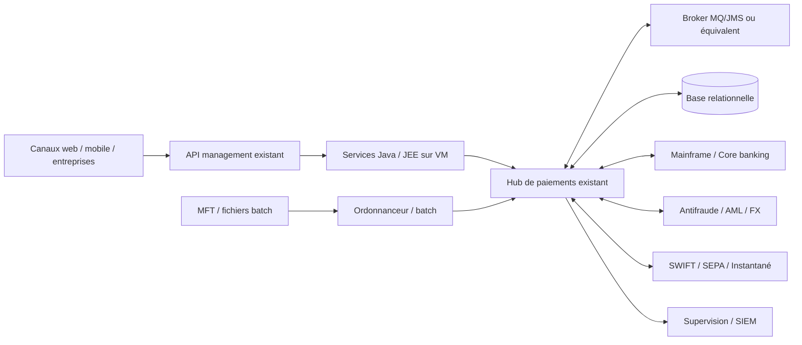

# AS-IS hypothétique et protocole de découverte

**Ce diagramme n'est la topologie d'aucune banque.** Il sert de checklist pour construire une cartographie réelle lorsque les éléments d'inventaire seront autorisés.

## Fiche d'inventaire obligatoire par application

`app_id, owner métier, owner technique, criticité, versions runtime/Java/JEE, OS, environnement, zones de sécurité, protocoles, formats, interfaces producteur/consommateur, TPS/débit, latence P50/P95/P99, fenêtres batch, dépendances, timeout, retry, ordre, MQ topics/queues, stockage durable, schema DB, licences, RTO/RPO, audit, données sensibles, certificats, monitoring, tests, mode retour arrière`.

## Démarche de collecte

- **D0** liste des capacités, produits, apps et tiers critiques ; refuser les équipements « boîte noire ».
- **D1** cartographie flux L2/L3 issue des journaux, API specs, MFT et broker (lecture seule).
- **D2** mesures métriques réelles en pointe et lors des rejets ; identifier les goulots.
- **D3** dépendances communes : référentiels, IAM, DNS, HSM, Oracle, MQ, ordonnanceur, NTP, certificats.
- **D4** matrice d'impacts des releases (cycle de vie/contrat versionné).
- **D5** validation atelier avec propriétaires et exploitation ; signature de complétude.

## Zones de risques classiques à vérifier

XA/JTA et transaction inter-ressources, base mutualisée, traitements batch non réentrants, sessions en mémoire, fichiers locaux, échanges JMS transverses, règles métier dans scripts, ordonnanceur central, versions Java dépendantes de serveurs anciens, SLA dépendants du mainframe, proxy HTTP avec retries implicites.
