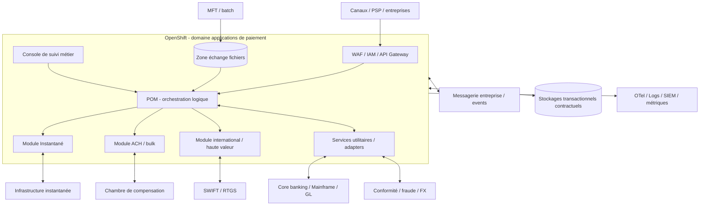

# HLD — Architecture cible de référence

## 1. Drivers

24/7 ; faible latence instantanée ; cohabitation batch/temps réel ; ouverture API ; sécurité de bout en bout ; minimisation des couplages ; réconciliation des paiements ; traçabilité ; évolutivité des rails ; conformité et coûts contrôlés.

## 2. Architecture logique L1–L2

**Lecture :** les noms des modules sont des capacités publiques (S01–S03). Les échanges internes, sens des connexions et choix de stockage illustrent une **PROPOSITION** sans préjuger du déploiement FIS. L'architecture peut répartir les composants sur VM ou OCP selon la matrice éditeur.

## 3. Responsabilités de domaines

| Domaine | Responsabilité | Contrat |
|---|---|---|
| Edge | AuthN/Z, WAF, termin TLS, throttling | OAuth/mTLS selon parcours, OpenAPI approuvée |
| POM | capture, préparation/routage, publication statut | Contrats POM réels FIS à obtenir |
| Execution | rails, schémas, règles, statut final | Format/protocole/fenêtre par rail |
| Integration | CBIS et services utilitaires | Adaptateurs contractuels et SLA |
| Data | vérité durable, transaction & preuve | atomicité, durabilité, backups |
| Event backbone | diffusion des événements métiers | at-least-once + idempotence ou contrat prouvé |
| Observability | santé, KPI, diagnostic, audit | SLI/SLO, traces minimisées PII |

## 4. Architecture de déploiement L4 proposée

Zones distinctes ingress/API, runtime paiements, middleware, data, réseaux bancaires externes, gestion/outillage. Multi-nœuds/zonage et politiques réseau deny-by-default. Aucune instance de base, broker ni module réel FIS n'est fournie par ce dépôt.

## 5. Chaînes critiques

- **Paiement instantané** : perte temporaire de réponse externe, priorisation de l'état ambigu, timer métier de bout en bout.
- **Batch/ACH** : fichiers atomiques, contrôles de complétude, batch chunking, rejet à l'élément et au lot.
- **International** : normes messages, routage, conformité, change, investigations, règles de cutoffs.
- **Canaux API** : retry contrôlé et consultation du statut avant émission d'une seconde commande.
- **Core banking** : indisponibilités programmées/inopinées, conservation du statut et reconciliation.

## 6. Invariants de design

- Aucun double débit/règlement dû à une défaillance du hub ; aucune perte silencieuse d'ordre accepté.
- Une propagation événementielle ne remplace pas l'accusé de règlement.
- Rollout sans perte de messages : arrêt gracieux/drain + tests d'incident.
- Pas de nouveau point unique de défaillance ; pas de dépendance entre disponibilité d'une API et celle d'un outil facultatif d'observation.
- Tous les traitements PII respectent finalité, minimisation, chiffrement et durée de conservation définies.

## 7. Gates de validation

G1 version OPF / support OCP / licences ; G2 contrats ; G3 crash/rejeu ; G4 performances ; G5 audit sécurité ; G6 PRA/test restauration ; G7 approbation opérationnelle. Voir [plan de recette](../07-validation/matrice-de-recette.md).
