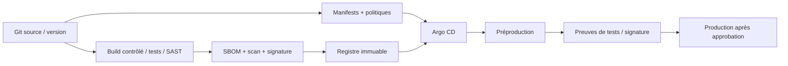

# LLD — Plateforme OpenShift et intégration de runtime FIS

## Précondition absolue

**Interdiction d'assimiler l'émulateur fourni à OPF** : une image FIS doit être obtenue contractuellement. Le fichier `poc/` ne valide que des patterns Kubernetes génériques. Il faut exiger une lettre écrite de compatibilité : version OPF **et modules**, Java/runtime, OCP, CSI/stockage, broker, DB, crypto, opérateurs, patch level et mode de support.

## Plan de déploiement souhaité

| Brique | Choix de référence | Condition |
|---|---|---|
| Workload | Deployments/StatefulSets **selon packaging éditeur** | Ne pas inventer un container par module |
| OCP | version sous support validé par éditeur | pas de numéro arbitraire figé |
| Namespaces | `payments-dev`, `payments-preprod`, `payments-prod`, `payments-ops` | environnements isolés et RBAC |
| Image | registre privé immuable digest SHA256 | signature, SBOM, antivirus, licence |
| Security | `restricted-v2` par défaut, UID dynamique et capacités Linux minimales | images compatibles ou exception validée |
| Service | interne ClusterIP / Route contrôlée sur edge | éviter exposition des backends |
| Secrets | coffres centralisés + rotation, CA d'entreprise | ne pas committer secrets |
| Rollout | selon protocole de cluster/version produit | rolling seulement si états/schémas compatibles |
| Scaling | HPA/VPA selon tests et support | vérifier DB pools, MQ consumers, cohérence |
| Availability | réplicas, PDB, anti-affinité/topologySpread | PDB ne protège pas d'un crash involontaire |
| Monitoring | collecte métriques/logs/traces contrôlée | ne pas exposer identifiants sensibles |

## Chaîne GitOps de référence

**Règle :** les modifications applicatives et configurationnelles suivent des workflows distincts ; rollback du manifest n'implique pas rollback de schéma DB ni effacement d'un ordre. Redéploiement seulement si la gestion d'état l'autorise.

## Probes / cycle de vie

- `startupProbe` : démarrage réel, migration initiale, warm-up (ne pas rendre la sonde dépendante d'un appel rail externe).
- `readinessProbe` : capacité locale d'accepter de **nouvelles** demandes, pas santé totale de l'écosystème.
- `livenessProbe` : deadlock irrécupérable uniquement ; toute dépendance extérieure transitoire ne doit pas tuer un pod.
- `preStop` / SIGTERM : fermer l'admission, drainer/tracer/restituer tâches, respecter `terminationGracePeriodSeconds`.
- Timeouts calculés en tenant compte des traitements et du budget métier.

## Plan d'intégration et sécurité

- `NetworkPolicy` deny-all ingress/egress ; règles explicites DNS/API/middlewares/données/observabilité ; tests effectifs via capture de flux autorisée.
- Egress externe via passerelles tracées, MTLS/cert management, DNS et NTP d'entreprise.
- `ServiceAccount` dédiée sans token API auto-monté si inutile ; RBAC restrictif.
- Read-only filesystem si supporté ; volumes scratch dédiés pour répertoires temporaires.
- Scan d'image et d'admission des conteneurs ; `oc adm policy` seulement après approbation.

## Tests d'acceptation OCP

OCP-01 admission SCC ; OCP-02 non-root ; OCP-03 connexion DB/broker ; OCP-04 isolement inter-namespace ; OCP-05 liveness/readiness ; OCP-06 drain ; OCP-07 rolling/rollback ; OCP-08 saturation ; OCP-09 certificats ; OCP-10 secret rotation ; OCP-11 HA ; OCP-12 restauration ; OCP-13 upgrades ; OCP-14 échec DNS ; OCP-15 réseau sortant interdit.
