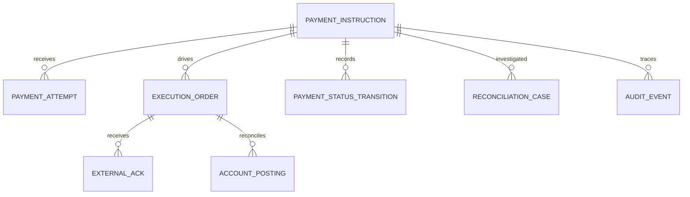

# Architecture des données et modèle conceptuel

## Entités métier (PROPOSITION, non schéma FIS)

| Entité | Identifiant conceptuel | Contenu | Rétention à définir |
|---|---|---|---|
| PaymentInstruction | instructionId | demande, montant, devise, références | conformité / juridique |
| PaymentAttempt | attemptId | tentative technique, canal, latence | exploitation |
| ExecutionOrder | executionId | instruction adressée au moteur/rail | conformité |
| PaymentStatusTransition | transitionId | avant/après, cause, autorité, date | audit |
| ExternalAck | externalAckId | reçu technique / métier | preuve de livraison |
| AccountPosting | postingId | écriture/solde, justificatif | tenue de compte |
| ReconciliationCase | reconciliationId | corrélation, écart et résolution | contrôle financier |
| AuditEvent | auditId | acteur, action, contrôles et provenance | audit |

La modélisation réelle sera alignée sur le dictionnaire FIS, les identifiants de schéma de paiement et le Core Banking ; ne jamais déduire du modèle logique la structure des tables OPF.

## Schéma conceptuel

## Garanties et consistency model

- Une seule **source d'autorité par transition**, explicitement identifiée, est requise.
- Définir les frontières ACID locales et transactions distribuées possibles ; ne pas supposer XA/JTA ou exactement-once global.
- Interdire la correction silencieuse d'une écriture réglée : retour/compensation traçable.
- Eventual consistency uniquement sur les projections où elle est autorisée ; jamais au détriment des obligations réglementaires.
- Versionner les transformations, conserver origine/horodatage et preuves de mapping.
- Qualité : unicité, complétude, format IBAN/BIC, montants, devise, corrélation, non-régression.
- RGPD : minimiser PII, rétention par finalité et contraintes légales, habilitations, chiffrement au repos/en transit.

## Réconciliation

1. Extraction contrôlée des ordres acceptés.
2. Corrélation des événements rail / Core Banking / compte selon références contractuelles.
3. Détection non-réglé, réglé sans ordre, montant/devise divergents, doublon.
4. Classification et ticket avec propriétaire, délai, escalade.
5. Action réparable signée ou preuve d'impossibilité ; journal irréversible.

## Sizing et gouvernance

Dimensions : TPS nominal/pointe, tailles messages, rétention, taux d'échec, index, archivage, WAL/redolog, réplication, disponibilité sauvegardes, latence disque, débit réseau. Taille cible à calculer avec mesures ; pas de taille chiffrée inventée.
