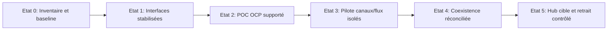

# Architecture de transition et feuille de route

## États de transition

## Ordre des chantiers

| Phase | Dépendance | Livrables | Stop/Go |
|---|---|---|---|
| P0 cadrage | aucun | inventaire, AS-IS, unknowns | owners désignés |
| P1 support/contrats | P0 | lettre FIS, licence, OpenShift matrix | Go éditeur |
| P2 conception | P1 | HLD/LLD/ADR, zonage, PIA | Design Authority |
| P3 POC | P2 | runtime autorisé OU émulateur contractuel | preuve sans confusion |
| P4 qualification | P3 | test rails, états, perf, résilience, sécurité | zéro doublon inexpliqué |
| P5 industrialisation | P4 | GitOps, DR, runbooks, audit et SLA | go SRE/risk |
| P6 migration incrémentale | P5 | isolation fonctionnelle, rapprochement, rollback | business sign-off |
| P7 stabilisation | P6 | KPI, dette, retrait ancien, revue financière | bilan mesuré |

## Architecture de transition concrète

- Edge : une **seule** source de routage pour chaque instruction, identifiant de bascule déterministe (canal/produit/règle), tracer la décision.
- Ancien hub : continuer les flux non migrés, n'introduire aucun deuxième writer actif d'un même paiement.
- Nouveau hub : router un sous-ensemble fonctionnel validé et observé ; reverser les statuts vers le service de consultation.
- Contrôles : double lecture possible pour comparaison, **pas de double exécution** d'une opération financière.
- Data : mécanisme de réconciliation ancien/nouveau, écarts résolus avant ramp-up.

## Déploiement temporel générique, par chantier

J+5 ouvrés : compte rendu et fiche inconnus ; J+15 ouvrés : architecture cible/de transition versionnée ; J+20 ouvrés : cartes détaillées et décision d'architecture. Suivi hebdomadaire et revue du registre des dépendances. Les délais sont une **cadence-type de gouvernance**, pas la preuve d'un projet passé.

## Bascule et retour arrière

Réaliser un rehearsal ; fixer seuils d'arrêt, point de non-retour métier, procédure réconciliation ; isoler la cohorte ; activer canary et étendre par lot uniquement après bilan. Un rollback applicatif ne rembobine jamais des paiements réglés.
